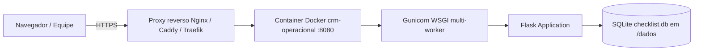

# Arquitetura e Estrutura do Projeto — CRM Operacional

Este documento descreve a arquitetura interna, o fluxo de dados, a organização dos diretórios e os padrões adotados no CRM Operacional (checklist pós-venda).

---

## Mapa de Diretórios

```
crm-operacional/
├── app/                           # Código-fonte da aplicação
│   ├── __init__.py                # App Factory (create_app), segurança, sessão e contexto whitelabel
│   ├── acoes_tarefa.py            # Operações em tarefas (status, datas, lançamentos, notas)
│   ├── andamento.py               # Motor de cálculo de progresso até o embarque
│   ├── catalogo_inicial.py        # Carga padrão (idempotente) do catálogo de trilhas e etapas
│   ├── cli.py                     # Comandos de terminal (catalogo, seed-demo, backup, diagnostico...)
│   ├── consultas.py               # Consultas, filtros, agrupamentos ("Organizar por") e agregações
│   ├── extensions.py               # Instâncias do SQLAlchemy e Migrate
│   ├── manutencao.py               # Diagnóstico de integridade e backup do banco
│   ├── painel_executivo.py        # Métricas e encaixe do grupo de backlog no painel HTML
│   ├── publico_teen.py            # Regras de detecção do público teen
│   ├── rsa.py                     # Encaixe e isolamento (sandbox) do painel RSA
│   ├── seed_demo.py               # Dados de demonstração fictícios (flask seed-demo)
│   ├── texto.py                   # Normalização de texto e separação da NEG
│   ├── vistos.py                  # Normalização e rotulagem de tipos de visto
│   ├── dados/                     # Tabelas auxiliares (SLA por categoria de pauta)
│   ├── importacao/                # Pipeline de importação de arquivos
│   │   ├── base_alunos.py         # Planilha semanal (histórico; só usada nos testes)
│   │   ├── checklist.py           # Relatório de checklist do ERP (CSV)
│   │   ├── consultores.py         # Mapeamento e reconciliação de nomes de consultores
│   │   ├── leitor_csv.py          # Parser e normalizador de CSV
│   │   ├── leitor_excel.py        # Leitor rápido de planilhas com Calamine (fallback openpyxl)
│   │   ├── pautas.py              # Pautas (CSV/MHTML): parser, SLA e upsert seguro
│   │   ├── rotulos.py             # Dicionários de rotulagem e legendas de importação
│   │   └── valores.py             # Parsers de datas, números e valores monetários
│   ├── models/                    # Modelos ORM (SQLAlchemy 2.x)
│   │   ├── base.py                # Helpers comuns (agora(), enums como texto + CHECK)
│   │   ├── cadastro.py            # Usuario, Papel, Aluno, Compra, Programa, ServicoCatalogo
│   │   ├── catalogo.py            # Trilha, EtapaModelo, ApelidoEtapa
│   │   ├── importacoes.py         # Importacao, OcorrenciaImportacao, Gravidade
│   │   ├── pautas.py              # Pauta, PautaAnotacao, PautaHistorico, ColaboradorSetor
│   │   └── tarefas.py             # Tarefa, Anotacao, HistoricoTarefa, StatusTarefa
│   ├── static/                    # CSS puro, JS da barra lateral e logotipo SVG
│   │   ├── estilo.css             # Identidade visual (cores nas variáveis do :root)
│   │   ├── lateral.js             # Recolher/abrir a barra lateral
│   │   └── logo-crm.svg           # Emblema do sistema (favicon, topbar e login)
│   ├── templates/                 # Templates Jinja2
│   │   ├── base.html              # Layout mestre (topbar, barra lateral, mensagens)
│   │   ├── entrar.html / trocar_senha.html  # Login e autoatendimento de senha
│   │   ├── fila.html / tarefa.html / programa.html / busca.html
│   │   ├── concluidas.html / para_lancar.html / andamento_vistos.html
│   │   ├── pautas.html / pauta.html         # Módulo de pautas (pipeline e detalhe)
│   │   ├── filas/                 # Parciais das visualizações (lista, kanban, quadro, calendário)
│   │   ├── cadastros/             # Telas administrativas (usuários, catálogo, serviços, setores)
│   │   ├── importacoes/           # Upload e prévia de importações
│   │   ├── painel/                # Painel Executivo
│   │   └── rsa/                   # Página de hospedagem do painel RSA
│   └── web/                       # Blueprints e controladores
│       ├── __init__.py            # Registro dos blueprints, filtros Jinja2 e CSRF
│       ├── auth.py                # Login, logout, troca de senha e rate-limiting
│       ├── filas.py               # Filas, Concluídas e Para Lançar
│       ├── tarefas.py             # Ações sobre tarefas
│       ├── programas.py           # Página do programa do aluno
│       ├── importacoes.py         # Upload e confirmação com prévia
│       ├── painel.py              # Painel Executivo (upload/download)
│       ├── pautas.py              # Pautas: pipeline, estados, observações e exportação
│       ├── rsa.py                 # Serviço do painel RSA (iframe isolado)
│       └── cadastros.py           # CRUD de usuários, catálogo, serviços e setores
├── docs/
│   └── REGRAS_CHECKLIST.md        # Regras de negócio do checklist pós-venda
├── migrations/                    # Migrações Alembic (batch mode)
├── scripts/                       # Inicialização local (PowerShell) e exportação de pautas
├── tests/                         # Suíte pytest (~290 testes, só dados fictícios)
│   ├── amostras/                  # Arquivos de exemplo gerados por código
│   └── test_*.py                 # Um módulo por área (auth, importações, pautas, web, migrações...)
├── config.py.exemplo              # Modelo de configuração de produção
├── docker-compose.yml / Dockerfile  # Deploy com volume persistente e migração automática
├── iniciar.cmd / iniciar_linux.sh # Inicializadores locais (waitress / gunicorn)
├── checklist.service              # Unit systemd para servidores Linux
├── servidor.py                    # Servidor de produção Waitress (Windows)
├── wsgi.py                        # Ponto de entrada WSGI
└── REGRAS_PAUTAS.md               # Regras do módulo de pautas
```

---

## 1. Autenticação e Permissões

- **Senhas** com `werkzeug.security.generate_password_hash` (PBKDF2 com salt, mínimo de 10 caracteres).
- **Papéis** (`app/models/cadastro.py`):
  - `ADMIN`: cadastros, importações, painéis e usuários.
  - `CONSULTOR`: filas, alunos, tarefas, pautas e anotações.
  - `ESTAGIARIO`: acesso operacional às filas.
- **Primeiro acesso**: quem não tem senha pode usar a transição com `SENHA_PROVISORIA` (quando `LOGIN_PROVISORIO=1`) e é levado a definir a própria senha em `/trocar-senha`. Nunca vale para administradores.
- **Proteção contra força bruta**: rate-limiting em memória por IP e por conta (10 tentativas em 15 minutos, HTTP 429).
- **Cabeçalhos de segurança** em todas as respostas: `X-Frame-Options: DENY`, `X-Content-Type-Options: nosniff`, `Referrer-Policy: same-origin` e `Strict-Transport-Security` quando `ATRAS_DE_PROXY=1`.
- **CSRF**: todo POST exige token (`token_csrf()`), aceitando o campo `csrf` do formulário ou o cabeçalho `X-CSRF-Token` das chamadas fetch.

## 2. Identidade Whitelabel

O nome do sistema, da unidade e o domínio dos e-mails de exemplo vêm da configuração (`NOME_SISTEMA`, `NOME_UNIDADE`, `ESCOPO_PAINEL`, `DOMINIO_EMAIL_EXEMPLO`) e são expostos aos templates por um context processor em `create_app`. Nenhuma marca fica fixa em código ou template.

## 3. Importação de Dados

Pipelines isolados, sempre com **prévia antes de gravar** e **idempotência** (reimportar não duplica):

1. **Checklist do ERP** (`app/importacao/checklist.py`): relatório CSV com alunos, programas, compras e itens de procedimento; reconcilia por IDs externos, encerra itens que saíram do arquivo e alimenta a base do painel RSA.
2. **Pautas** (`app/importacao/pautas.py`): CSV/MHTML com upsert seguro — atualiza os dados oficiais, preserva observações, anotações e estados internos, e encerra o que saiu do arquivo.
3. **Planilha semanal** (`app/importacao/base_alunos.py`): leitor mantido para o histórico e para os testes do leitor Excel (Calamine).

A correspondência entre sistemas é **sempre por ID** (`aluno_id_erp`, `programa_id_erp`, `compra_id_erp`, `item_checklist_erp`), nunca por nome. A importação nunca sobrescreve status, responsável manual, datas planejadas ou anotações da equipe.

## 4. Banco de Dados e Migrações

- **SQLite** com `PRAGMA journal_mode=WAL`, `foreign_keys=ON` e `busy_timeout=30000` para acesso concorrente.
- **Migrações** Flask-Migrate/Alembic em modo batch, testadas com dados contra upgrade e downgrade (`tests/test_migracoes.py`).
- **Backups** atômicos pela API de backup do SQLite (`flask backup --manter N`), guardando os N mais recentes em `<dados>/backups`.

## 5. Implantação



- **Docker**: imagem `python:3.12-slim`; ao subir, roda `flask db upgrade` e aborta o container se a migração falhar. O volume `crm_dados` guarda banco, chave, backups e uploads.
- **Servidores Linux**: `iniciar_linux.sh` (gunicorn) ou `checklist.service` (systemd).
- **Windows**: `iniciar.cmd` + `servidor.py` (waitress) com reinício automático.
- **Chave de sessão**: sem `SECRET_KEY` configurada, o sistema gera e persiste uma chave forte em `<dados>/secret_key` e recusa valores de exemplo na subida.
